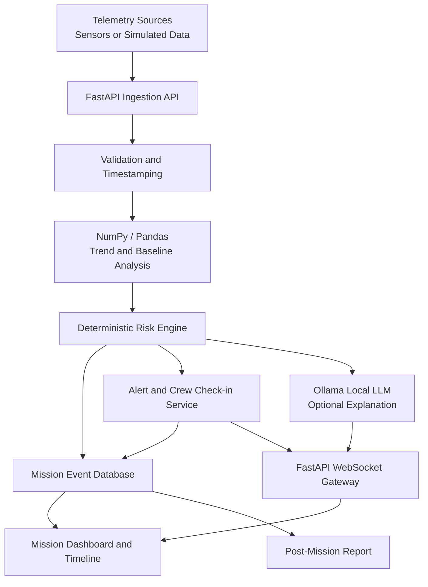

# 🚀 ORBIT — Offline Astronaut Health Monitoring System

> **Analyze · Understand · Protect**  
> An offline-first health-monitoring prototype designed to support astronaut crews throughout a space mission.

ORBIT is a NASA Space Apps Challenge project concept focused on monitoring astronaut health indicators, detecting unusual patterns, prompting crew check-ins, and preserving a complete mission health timeline for post-mission review.

The goal is not to replace medical professionals or autonomously diagnose disease. ORBIT is designed as a **decision-support prototype**: it combines deterministic data analysis with a local AI assistant so that core monitoring can continue even when internet access is unavailable.

---

## ✨ Why ORBIT?

Space missions can involve delayed communications, limited connectivity, and changing physical demands. A monitoring tool should therefore do more than display sensor values: it should identify potentially concerning changes, explain why an alert was raised, and keep an auditable record of what happened.

ORBIT aims to provide:

- 🛰️ **Mission-aware monitoring** for each crew member.
- 📈 **Trend and baseline analysis** of incoming health telemetry.
- ⚠️ **Explainable alerts** based on explicit rules and validated thresholds.
- 💬 **Crew check-ins** when a concerning pattern is detected.
- 🧠 **Local AI explanations** using a pre-downloaded language model through Ollama.
- 🔌 **Offline-first operation** with local storage and queued telemetry.
- 🗂️ **Mission history and post-mission reports** for review by qualified medical personnel.

## 🧭 Mission Workflow

1. **Configure a mission** — define its duration, crew members, mission phases, and monitoring profile.
2. **Generate a mission roadmap** — ORBIT can draft a structured monitoring schedule. The roadmap is validated against configured rules before use.
3. **Collect telemetry** — receive sensor data or use clearly labelled simulated data for the prototype.
4. **Analyze incoming measurements** — validate data, compare it with the crew member's baseline, and calculate trends.
5. **Evaluate risk** — a deterministic risk engine checks configured, documented rules and classifies events.
6. **Check in with the crew** — when appropriate, ask “Are you okay?” and record the crew member's response or lack of response.
7. **Record every event** — store measurements, alerts, timestamps, responses, and actions in the mission timeline.
8. **Review after the mission** — produce a chronological report that helps qualified clinicians assess the mission's health events.

> **Safety principle:** The local language model is not the sole source of risk decisions. Core alerts must work without Ollama, and a missing crew response must never automatically clear an alert.

## 🏗️ Proposed Architecture



### Main components

| Component | Responsibility |
|---|---|
| **FastAPI** | API endpoints, telemetry ingestion, mission configuration, and service coordination |
| **NumPy / Pandas** | Data cleaning, rolling statistics, trend analysis, baseline comparison, and anomaly features |
| **Risk Engine** | Rule-based evaluation using documented and appropriately validated thresholds |
| **Ollama** | Runs a pre-downloaded local language model to explain recorded findings in plain language |
| **WebSocket** | Pushes new measurements, alerts, and check-in status to connected dashboards in real time |
| **Database** | Stores mission configuration, telemetry, alerts, crew responses, and event history |
| **Dashboard** | Displays crew status, trends, alerts, mission progress, and post-mission summaries |

WebSockets provide live updates, but they are not the database or the only delivery mechanism. The backend should persist events first, handle reconnects, and support replay or resynchronization after a connection returns.

## 🧠 Hybrid AI: Rules + Local LLM

ORBIT separates **risk evaluation** from **natural-language explanation**.

- **Deterministic analysis:** validates measurements, calculates trends, and evaluates documented rules.
- **Local AI (Ollama):** summarizes already-computed findings, explains why a rule fired, and formats a draft mission plan or report.
- **Human oversight:** high-risk events follow a defined escalation protocol and remain visible to the appropriate crew or medical authority.

The local model must not invent measurements, silently change risk thresholds, prescribe treatment, or override a critical rule. AI-generated roadmap content should be schema-validated, checked against mission constraints, versioned, and approved before it becomes operational.

### Offline behaviour

- Download the model before going offline.
- Keep essential monitoring and alert rules independent of the LLM.
- Store data locally when the network is unavailable.
- Queue outgoing updates and synchronize them safely when connectivity returns.
- Use timestamps, stable event IDs, and idempotent writes to avoid duplicate records.
- Test CPU/RAM requirements and response time on the intended hardware.

“Offline-capable” means the required model and dependencies are already installed locally; it does not mean that every model runs on every device without resource constraints.

## 📡 Real-Time Monitoring and Crew Check-ins

When a rule identifies a potentially concerning measurement or trend, ORBIT can:

1. Record the triggering data and rule.
2. Send a dashboard alert over WebSocket.
3. Prompt the crew member with a short check-in, such as **“Are you okay?”**
4. Record the response, timestamp, and any reported symptoms.
5. Escalate according to the configured protocol if the response is concerning or absent.

Thresholds must be based on relevant medical and spaceflight guidance, not chosen arbitrarily. A prototype may use synthetic thresholds for demonstration, but they must be clearly labelled as simulated and **not suitable for real clinical use**.

## 🗃️ Mission Data and Post-Mission Review

A mission event should preserve enough context to understand what happened later. Depending on the implementation, records may include:

- Mission ID and crew member ID
- Measurement type, value, unit, and timestamp
- Data source and quality/validity status
- Baseline or trend features used in the evaluation
- Rule ID, risk category, and explanation
- Crew check-in prompt and response
- Acknowledgements and recorded actions
- Synchronization status and audit timestamps

After the mission, ORBIT can generate a timeline of events, highlight recurring patterns, summarize responses, and prepare a report for review by qualified medical professionals. The report supports clinical assessment; it does **not** independently determine a diagnosis or treatment.

## 🧰 Proposed Technology Stack

| Layer | Technology |
|---|---|
| Backend API | Python, FastAPI |
| Data analysis | NumPy, Pandas |
| Local language model | Ollama + a locally downloaded model |
| Live updates | WebSocket |
| Persistence | SQLite for a simple prototype; PostgreSQL for a multi-user deployment |
| Frontend | React / Next.js / Vite (choose based on the team’s implementation) |
| Testing | pytest, API/integration tests, simulated telemetry scenarios |
| Deployment | Local Linux environment; Docker optional |

The stack is a proposed implementation plan and may change as the prototype evolves.

## 📁 Suggested Project Structure

```text
orbit/
├── app/
│   ├── main.py
│   ├── api/
│   │   ├── missions.py
│   │   ├── telemetry.py
│   │   ├── alerts.py
│   │   └── reports.py
│   ├── core/
│   │   ├── config.py
│   │   └── logging.py
│   ├── schemas/
│   │   ├── mission.py
│   │   ├── telemetry.py
│   │   └── alert.py
│   ├── services/
│   │   ├── ingestion.py
│   │   ├── analysis.py
│   │   ├── risk_engine.py
│   │   ├── local_ai.py
│   │   ├── roadmap.py
│   │   └── reporting.py
│   ├── realtime/
│   │   └── websocket_manager.py
│   ├── db/
│   │   ├── models.py
│   │   ├── session.py
│   │   └── repositories.py
│   └── simulation/
│       └── telemetry_generator.py
├── tests/
│   ├── test_analysis.py
│   ├── test_risk_engine.py
│   ├── test_telemetry_api.py
│   └── test_offline_mode.py
├── frontend/
├── docs/
│   ├── architecture.md
│   └── safety-and-data-notes.md
├── .env.example
├── .gitignore
├── pyproject.toml
└── README.md
```

This is a suggested structure, not a claim that all modules have already been implemented.

## 🚦 Development Roadmap

### Phase 1 — Working monitoring foundation
- [ ] Define mission, crew, telemetry, and event schemas.
- [ ] Create a simulated telemetry generator.
- [ ] Implement FastAPI ingestion and validation.
- [ ] Add baseline/trend analysis and unit tests.
- [ ] Persist measurements and events.

### Phase 2 — Risk and real-time interface
- [ ] Implement a documented rule-based risk engine.
- [ ] Add WebSocket events and reconnection handling.
- [ ] Build crew status, alert, and mission timeline views.
- [ ] Implement the check-in workflow and no-response escalation.

### Phase 3 — Offline local AI
- [ ] Integrate Ollama as an optional local service.
- [ ] Validate model output against strict schemas.
- [ ] Generate draft mission roadmaps and event explanations.
- [ ] Confirm core monitoring works when Ollama is stopped.
- [ ] Measure resource use and latency on target hardware.

### Phase 4 — Mission closeout and demonstration
- [ ] Generate post-mission event timelines and summaries.
- [ ] Test network loss, reconnects, duplicate messages, and corrupted data.
- [ ] Demonstrate a simulated 30-day mission using accelerated playback.
- [ ] Document limitations and prepare the challenge presentation.

## 🧪 Example Demonstration Scenario

1. Create a simulated 30-day mission with several crew members.
2. Stream synthetic health telemetry through the ingestion API.
3. Inject a documented test scenario that triggers a warning.
4. Show the alert appearing on the dashboard in real time.
5. Record the crew check-in response.
6. Disconnect the network and verify local monitoring and persistence continue.
7. Stop Ollama and verify that core risk rules still operate.
8. Complete the simulated mission and generate a post-mission report.

All demonstration data must be labelled **synthetic**. This scenario is for software evaluation, not clinical validation.

## 🔐 Privacy, Reliability, and Safety

- Minimize personal and health data collected.
- Protect access to crew and mission records.
- Keep an auditable record of alerts and actions.
- Validate data quality before analysis.
- Do not treat missing, stale, or invalid sensor data as a normal reading.
- Do not allow an LLM response to suppress a deterministic critical alert.
- Test failure modes, including unavailable AI, dropped connections, and database errors.
- Have any thresholds or medical interpretations reviewed by appropriately qualified experts before any real-world use.

## 👥 Team Contributions

ORBIT is intended to be developed collaboratively. Suggested workstreams:

- **Backend & Local AI:** FastAPI, Ollama integration, roadmap generation, service orchestration.
- **Telemetry & Analytics:** simulated data, validation, NumPy/Pandas analysis, test cases.
- **Realtime & Persistence:** WebSockets, event history, synchronization, alert delivery.
- **Frontend & UX:** mission setup, dashboard, check-ins, and reports.
- **Integration & Research:** testing, evidence for thresholds, documentation, and presentation.

Assign owners and acceptance criteria for each module before parallel development begins.

## 🏆 Challenge Context

**Event:** NASA Space Apps Challenge 2026  
**Challenge:** *Create Health Monitoring Software for Astronauts on Space Missions*

ORBIT is a challenge prototype concept. Any claims about operational readiness, medical accuracy, or suitability for spaceflight require evidence and validation beyond a demonstration.

## 📄 Project Status

**Status:** Architecture and development plan

The proposed features and structure above describe the intended design. Update this section as modules are implemented and tested; do not present planned functionality as completed functionality.

## 📜 License

Choose and add a license before publicly distributing the project. Make sure all model, dataset, icon, and third-party dependency licenses are compatible with your intended use.

---

**ORBIT — Analyze · Understand · Protect**  
*When Earth is far, your data keeps you close.*
